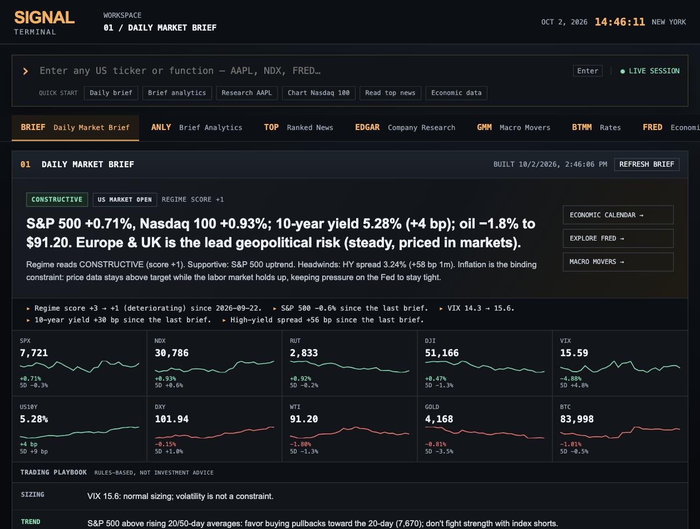

# Signal Terminal

Signal Terminal is a self-hosted market terminal that runs in one Docker container and is served on localhost. It polls public RSS feeds for headlines, pulls prices from Yahoo Finance, economic series from FRED and filings from SEC EDGAR, and combines them into a rules-based daily market brief with a regime score, a cross-asset tape, sector rotation and a catalyst calendar. No API key or paid data subscription is needed for the core features.



The screenshot shows live public market data from 2 October 2026. The app holds no account or trade data.

**Live:** <https://signal.alenlvovich.com> (read-only public view).

## What it shows

Each view has a short function code that can be typed into the command line at the top.

| Code | View |
| --- | --- |
| `BRIEF` | Daily market brief: posture, regime score, what changed since the last brief, price tape with 30-day sparklines, playbook, catalysts, risks, headlines. |
| `ANLY` | The analytics behind the brief: regime components, breadth, economic data table, Fed pricing, index levels, geopolitics by region, sector rotation, watchlist relative strength. |
| `TOP` | Headlines ranked by a heuristic score (recency, event type, tickers mentioned, market language). |
| `EDGAR` | Company lookup by US ticker or CIK: profile, ratios, annual and quarterly XBRL facts, five-year history, recent filings, related news. |
| `GMM` | Cross-asset movers with 1-day, 5-day and 1-month changes across equities, rates, FX, commodities, crypto and volatility. |
| `BTMM` | Fed funds, SOFR and 2/10/30-year Treasury yields, a yield-curve chart and an economic calendar. |
| `FRED` | Twelve transformed economic series covering inflation, labor, growth, demand and financial conditions. |
| `MON` | Editable watchlist with last price, daily move, 5-day relative strength against the S&P 500 and trend state. |
| `ALRT` | Alert rules on keywords, the watchlist, or a market condition from the brief (for example VIX above 20). |
| `SET` | Feed list with enable/disable controls and connection health. |

Typing a US ticker such as `AAPL` opens company research. Selecting a headline opens a built-in reader where the publisher allows extraction.

The brief (`brief.py`) is rules-based. It scores trend, momentum, volatility, credit, breadth, participation, rotation, rate shock and the dollar, merges near-duplicate headlines, and keeps one snapshot per day so it can report what changed. It is research output, not investment advice.

## Run it

Requires Docker with Compose and an internet connection.

```bash
docker compose up -d --build
```

Open <http://localhost:8080>. The port is bound to 127.0.0.1 only. Settings, alert rules, headline history and brief snapshots are stored in the `news-cache` volume and survive `docker compose down`.

To run without Docker (Python 3.10 or later):

```bash
pip install -r requirements.txt
python server.py
```

Run this way, the server listens on all interfaces, not just localhost, and writes its cache to `./data`.

## Public read-only deployment

[`deploy/compose.public.yaml`](deploy/compose.public.yaml) runs the live copy at signal.alenlvovich.com on a home PC:

1. `signal-puller` (alpine/git) clones this repo into the `signal-repo` volume and runs `git pull` every 60 seconds.
2. `signal-terminal` (python:3.13-slim) runs `server.py` from that volume on `127.0.0.1:8098` and restarts itself when Python code or `requirements.txt` changes. HTML, JS and CSS changes go live on the next pull.
3. A Cloudflare Tunnel publishes `localhost:8098` as `signal.alenlvovich.com`.

Pushing to `main` deploys within about a minute. `PUBLIC_HOSTS=signal.alenlvovich.com` lets that hostname read every view; settings, watchlist, alert-rule and brief-refresh writes still return 403 unless the request comes from localhost, and the settings token is never sent to public visitors. No Anthropic key is set on the public copy.

```bash
docker compose -f deploy/compose.public.yaml up -d
```

## Owner view and live Schwab quotes

The public copy runs on delayed Yahoo Finance prices. The owner can switch on live quotes from the Schwab Trader API for themselves only:

- `http://localhost:8098/owner` (only reachable on the host PC) shows a private owner link and a Schwab connect form. Keys and tokens are stored in the data volume (`schwab.json`), never in the repo.
- Opening the owner link once on a phone or laptop sets an `HttpOnly` owner cookie. The key travels in the URL fragment, so it never reaches the server logs.
- With the cookie, `static/live.js` overlays Schwab last prices on the price tape and watchlist every two seconds and shows a `LIVE · SCHWAB` badge. Visitors get `{"owner": false}` from `/api/owner/status` and a 403 from `/api/live/quotes`, so their browsers never receive Schwab data.
- Live quotes have their own cache; the shared brief, movers and watchlist views keep using delayed data, so nothing the public sees is derived from Schwab.

Why owner-only: Schwab's account agreements license market data for the account holder's personal, non-commercial use and forbid redistributing it. An individual Trader API app is not approved to serve other users. Schwab sign-in lasts 7 days; the badge turns amber when it needs renewing.

## Configuration

Set these in the shell or in a `.env` file next to `compose.yaml`. All are optional.

| Variable | Default | Purpose |
| --- | --- | --- |
| `SEC_USER_AGENT` | placeholder | Name and contact email sent to SEC EDGAR, which asks automated clients to identify themselves. |
| `ANTHROPIC_API_KEY` | unset | Adds a Claude-written analyst note to the brief. Each note is a paid API call. Without a key nothing is sent to Anthropic. |
| `BRIEF_MODEL` | `claude-opus-5` | Model used for the analyst note. |
| `POLL_SECONDS` | `30` | Feed polling interval, minimum 15. Set in `compose.yaml`. |
| `DATA_DIR` | `/data` in Docker | Cache directory. |
| `PUBLIC_HOSTS` | unset | Comma-separated hostnames allowed a read-only view from outside localhost, for example `signal.alenlvovich.com`. |

Feeds, the watchlist and alert rules are edited in the app.

## Data sources

- Headlines: public RSS and Atom feeds (CNBC, BBC, Federal Reserve, Yahoo Finance, MarketWatch and others), polled every 30 seconds and pushed to the browser over server-sent events.
- Prices: Yahoo Finance chart endpoint, fetched server-side and cached for five minutes per symbol.
- Economic data and rates: FRED public CSV downloads.
- Company data: SEC submissions and company-facts APIs, cached for 15 minutes and limited to four requests per second.
- Charts and the economic calendar: TradingView embed widgets, loaded by the browser.

## Known limitations

- RSS is not a real-time newswire. Publisher delay comes on top of the polling interval.
- The Yahoo Finance endpoint is unofficial and can be rate-limited or changed without notice. When it fails, the brief and movers views report that market data is unavailable.
- TradingView widgets depend on TradingView's availability and symbol entitlements.
- The relevance score and regime score are hand-tuned heuristics. They have not been backtested.
- The catalyst calendar includes a hardcoded list of Federal Reserve and BLS dates in `brief.py`, which has to be updated by hand.
- The article reader fails on paywalled pages and unusual markup.
- There are no automated tests.
- Single user, no login. Settings writes require a session token and a localhost Host header. Hostnames in `PUBLIC_HOSTS` get a read-only view; there is no way to edit from the internet.
- The Benzinga stream client is implemented but has not been run against a live subscription. The settings dialog has no field for the key.
- Headlines are capped at the latest 600 and alerts at 100.
- `static/app.js` is one 300-line file without a build step or comments.

## Project structure

```
server.py          HTTP server, feed polling, price/FRED/SEC fetchers, settings, SSE
brief.py           daily market brief engine and optional analyst note
schwab.py          owner-only Schwab Trader API client (OAuth, token refresh, quotes)
static/
  index.html       single page with all views
  app.js           client logic
  live.js          owner-only live quote overlay
  login.html       owner sign-in (via owner link)
  owner.html       host-only setup: owner link, Schwab connection
  *.css            styles per view
deploy/
  compose.public.yaml  auto-updating public deployment (signal.alenlvovich.com)
Dockerfile         python:3.13-slim, non-root user
compose.yaml       localhost-only port, read-only filesystem, cache volume
requirements.txt
```
